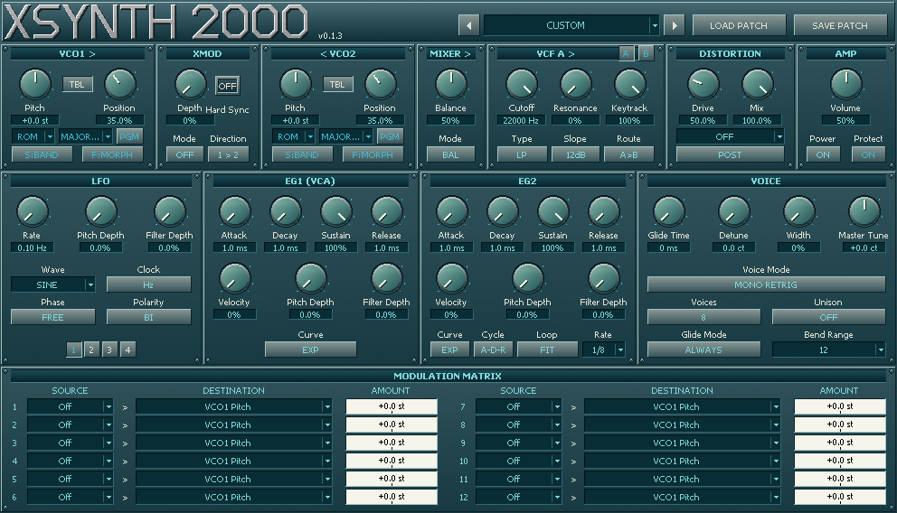

# Xsynth 2000

**Windows x64 VST3 · Developed by Phaos**

[Website](https://phaos.neocities.org/) · [Email](mailto:phaos2000@pm.me) · [Latest release](https://github.com/Phaos2000/xsynth-2000/releases/tag/v0.1.3)

Xsynth 2000 is a digital synthesizer developed from Steve J. Brookes' **Xsynth 1.0.2 (1999)**.

What began as a Windows VST3 port grew into a substantially expanded instrument, with a larger oscillator and filter architecture, four independent LFOs, a 12-slot modulation matrix, polyphony, Unison, historical patch compatibility and a new retro-style interface.

*Xsynth 2000 v0.1.3, STEEL theme. Download the Windows plugin from the latest release.*

## To-Do / Being done

Completed in the current development source on `main`:

- [x] Distortion module: ten algorithms, PRE / POST placement and extended Drive range.
- [x] Factory wavetable bank and folders: 69 tables, including 33 original additions, chord/scale voicings and dedicated SFX.
- [x] USER waveform slots and native-patch embedding.
- [x] Stereo Unison width and selectable voice budgets up to 64 members.
- [x] Combined VCO Shape / Position modulation destinations.
- [x] Audible harmony voicing/scale movement, stronger RAIL STEPS states and a clearer played-note anchor in TILT CLUSTER.
- [x] One shared set of factory folders in both waveform browsers; destinations display correctly while Source is OFF.
- [x] 19-, 24- and 31-EDO Harmony tables: Position ascends through every scale step over one octave.
- [x] EG2 tempo sync and dual-filter routing.
- [x] Targeted fix for the supplied Wave-modulation CPU spike: about 57% less processing in the paired different-note replay, with identical audio.

Still open:

- [ ] Complete manual listening and level/variety review of the revised factory bank, especially its five harmony voicings.
- [ ] Continue targeted voice/CPU optimization where real-host testing identifies remaining hotspots.
- [ ] Maybe some more filter types...
- [ ] Scala and `.tun` file support for keyboard tuning.

The v0.1.3 package includes the completed work above; real-host and listening acceptance remain open as listed. See [current development validation](expansion/docs/CURRENT-DEVELOPMENT.md) for measured scope.

## Instrument

Xsynth 2000 has two oscillators, each with **CLASSIC**, **CLEAN** and **RASTER** rendering.

**CLASSIC** preserves the direct digital oscillator behavior, including aliasing as part of the sound. **CLEAN** provides an alternate reduced-aliasing implementation without changing oscillator tuning. Xsynth 2000 is a digital synthesizer rather than an attempt to emulate a particular analog instrument.

### Highlights

- Two oscillators with independent **CLASSIC / CLEAN / RASTER** rendering
- **−24 to +24 semitone** oscillator range
- FM, PM and hard sync
- BAL / SUM / RING / AM / XOR / DIFF oscillator mixing
- Two VCFs with LP / HP / BP / NOTCH modes, serial/parallel routing and keytracked self-oscillation
- 12 / 24 dB/oct filter slopes and keytracking
- Two expanded envelope generators, including tempo-synchronized looping EG2
- **Four complete independent LFOs**
- Tempo-synchronized LFO operation
- **12-slot modulation matrix**
- **13 active modulation sources**, plus OFF
- **44 visible modulation destinations**, including combined Shape / Position per VCO
- Polyphonic and monophonic voice modes
- Selectable **1 / 2 / 4 / 8 / 16 / 32 / 64 physical-voice budgets**
- Unison OFF / 2 / 4 / 8 with dynamic group normalization
- Glide, pitch bend and master tuning
- **69 factory wavetables** in folders, including five chord/scale voicings, three microtonal scale tables and dedicated SFX
- Nine shared factory folders: SPECTRAL, PULSE, FORMANT, DIGITAL, MODULATION, INSTRUMENTS, PAD, HARMONY and SFX
- Harmony Position moves through rising, falling or returning voicings and pentatonic lines while retaining the approved opening sounds
- 19 EDO RISE, 24 EDO RISE and 31 EDO RISE transpose through their complete octave scales as Position rises; both STEP and MORPH retain precise scale steps
- Sixteen wavetable frames, HOLD / LINEAR / BAND reading and STEP / MORPH Position
- Sixteen USER waveform slots with native-patch embedding
- Ten distortion algorithms with PRE / POST placement and 0–200% Drive
- Stereo Unison width
- Coherent Wave-modulation optimization with independent unison oscillator histories
- Historical factory preset browser
- Original Xsynth `.Xpatch` import
- Xsynth-DSSI format 0/1 bank import
- Native Xsynth 2000 user patches
- Six interface themes
- Resizable GUI with remembered size
- Windows x64 VST3

## Historical context

The original **Xsynth** was written by **Steve J. Brookes in 1999** as a realtime MIDI-controlled software synthesizer for Linux.

It was a standalone X11/OSS application with a deliberately compact architecture: two oscillators with pitch, balance and sync, one LFO, two envelope generators, a low-pass filter and portamento. The original instrument was monophonic with highest-note priority.

Xsynth later provided the foundation for **Xsynth-DSSI**, which extended the design into the early Linux software-instrument ecosystem.

Xsynth 2000 retains Steve Brookes' original work as its historical and code foundation, but its synthesis engine, modulation system, voice architecture, Windows VST3 implementation and graphical interface have been substantially expanded.

## Original Xsynth vs. Xsynth 2000

| Area | Xsynth 1.0.2 (1999) | Xsynth 2000 |
| --- | --- | --- |
| Platform | Linux / OSS / X11 standalone | Windows x64 VST3 |
| Voice architecture | Monophonic, highest-note priority | Polyphonic and monophonic modes; selectable voice budgets up to 64, shared with Unison |
| Oscillators | 2 oscillators, pitch, balance and sync | 2 oscillators with WAVE / ROM / USER sources, −24 to +24 semitone tuning, FM, PM and hard sync |
| Oscillator rendering | Original direct digital rendering | Independent CLASSIC / CLEAN / RASTER engines; CLASSIC retains the original digital character |
| Oscillator mixing | Balance | BAL, SUM, RING, AM, XOR and DIFF |
| Factory wavetables | No wavetable bank | 69 tables in nine shared folders, with 16 timbre frames each; includes five harmony voicings, three microtonal scales and dedicated SFX with three digital noise characters |
| Microtonal Position | No microtonal scale tables | Complete 19-, 24- and 31-EDO octave ascents in Harmony; scale pitch is precise and independent of timbre-frame interpolation. Scala/`.tun` keyboard import is planned |
| Wavetable motion | No wavetable Position control | HOLD / LINEAR / BAND reading; STEP / MORPH Position, with modulation of Position |
| User waveforms | No USER wavetable slots | 16 USER slots, waveform import and programmer; waveform data embedded in native patches |
| Filter modules | One low-pass filter | Two independent filter modules, A and B; each has LP / HP / BP / NOTCH, 12/24 dB slopes, resonance and keytracking |
| Filter routing | One filter path | A only, B only, A→B, B→A or A+B parallel routing |
| Distortion | No dedicated distortion module | Ten algorithms, PRE / POST placement, Dry/Wet mix and 0–200% Drive |
| LFOs | 1 LFO | 4 independent LFOs; tempo sync, retrigger/phase options and random waveforms |
| Envelopes | 2 envelope generators | 2 expanded envelopes with curve and velocity controls; EG2 looping, tempo sync and FIT / LIMIT modes |
| Modulation | Fixed routing; MIDI modulation to filter cutoff | 12 routes, 13 active sources plus OFF, and 44 visible destinations; combined Shape / Position per VCO |
| Unison and stereo | No Unison section | OFF / 2 / 4 / 8-way Unison, detune, stereo width and dynamic group normalization |
| Voice controls | Mono with portamento | Poly/mono, retrigger/legato modes, selectable glide behavior, pitch-bend range, master tuning, sustain and sostenuto |
| Presets | Original patch format | Historical presets, native patches, Xsynth and Xsynth-DSSI import |
| GUI | X11 control panel | Resizable VST3 interface with six themes, waveform folders, waveform programmer and remembered size |

## Historical patch compatibility

Original Xsynth `.Xpatch` files and historical Xsynth-DSSI patch/bank formats can be imported.

A development compatibility corpus of **239 historical/community Xsynth-DSSI patches** was successfully parsed and converted.

Xsynth-DSSI import is intended for useful musical migration rather than bit-identical emulation. The two engines differ in several areas of synthesis and voice behavior.

## Controls

Knobs drag vertically. Hold **Shift** for fine adjustment and double-click to restore the default value.

VCO Pitch uses exact semitone steps for ordinary dragging and mouse-wheel movement, with Shift available for continuous fine adjustment.

Cycling controls use:

- **Left-click:** next value
- **Right-click:** previous value
- **Mouse wheel:** forward/backward where applicable

Dropdown menus open on a completed click and remain open for normal selection.

The LFO Wave selector uses the same complete list for menu and mouse wheel:

**SINE → TRI → SAW UP → SAW DN → SQUARE → PULSE → S&H → SMOOTH**

All four LFOs run independently. The `[1] [2] [3] [4]` buttons select which LFO is currently being edited.

Matrix Amount supports horizontal or vertical dragging, automatically locking to the dominant drag direction. Shift provides fine adjustment and double-click returns the amount to zero.

## Presets

The preset browser contains **INIT** plus fifty historical records across three banks:

- 42 sounds
- 8 informational entries
- original intentional duplicates preserved

`LOAD PATCH` can also import Xsynth and Xsynth-DSSI patches/banks.

`SAVE PATCH` writes native `.XseDev` patches without modifying factory data. The filename stem is used as the displayed patch name.

## Themes

Click the logo to open **About**.

The `THEME` control cycles through:

**STEEL** · **98** · **INDUSTRIAL** · **MULTIMEDIA** · **2000** · **SAND**

STEEL is the default.

Theme and GUI-size preferences are stored separately from patches, so changing the appearance does not alter the sound or preset state.

## Validation

The published v0.1.1 checkpoint passed:

- **24 / 24 regression suites**
- **Steinberg validator: 47 passed / 0 failed**
- linked-plugin integration checks
- state and automation migration tests
- multi-rate / multi-buffer DSP tests
- six-theme and GUI interaction checks

The current release also includes performance optimization of the expanded four-LFO / twelve-route engine. Extreme 96 kHz, 32-voice workloads remain intentionally documented as stress cases rather than being hidden through reduced synthesis quality.

Current main includes the factory wavetable bank, shared Shape / Position routing, an exact-audio Wave-modulation CPU fix and the v0.1.3 Position/tuning/browser corrections. See [current development validation](expansion/docs/CURRENT-DEVELOPMENT.md) for measured scope. Manual listening and real-host CPU acceptance remain separate from offline validation.

## Installation

1. Download the latest Windows x64 package from [Releases](https://github.com/Phaos2000/xsynth-2000/releases).
2. Extract the ZIP.
3. Copy the complete `Xsynth 2000.vst3` bundle to:

   `C:\Program Files\Common Files\VST3\`

4. Rescan VST3 plugins in your DAW if necessary.

## Source and license

Xsynth 2000 is distributed under **GPL-2.0-or-later**.

Original Xsynth code:

**Copyright © 1999 S. J. Brookes**

Xsynth 2000 synthesis development, Windows VST3 implementation and GUI:

**Copyright © 2026 Phaos**

Matching source and SHA-256 checksums are provided with each release.

Phaos  
https://phaos.neocities.org/  
phaos2000@pm.me
